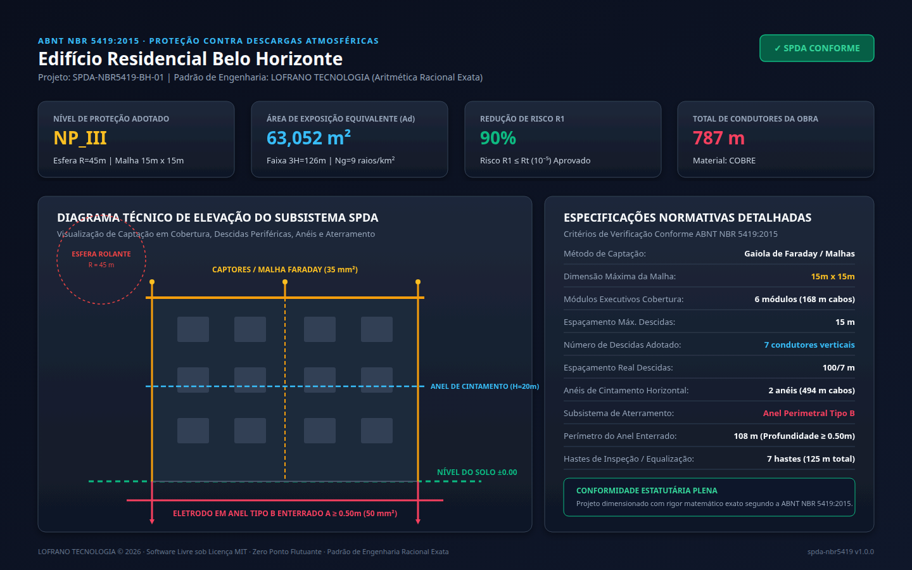

# Dimensionamento de SPDA · ABNT NBR 5419:2015

[](https://github.com/martinlofranodeoliveira/dimensionamento-spda-nbr5419/actions/workflows/ci.yml)
[](https://www.python.org/)
[](LICENSE)
[](https://www.abnt.org.br/)
[-purple.svg)](#aritmética-racional-exata)

Motor analítico, determinístico e interface de linha de comando (CLI) para gerenciamento de risco, avaliação estatística e dimensionamento completo do Sistema de Proteção contra Descargas Atmosféricas (SPDA) conforme as quatro partes da norma brasileira **ABNT NBR 5419:2015** (*Proteção contra descargas atmosféricas*).

Desenvolvido segundo o padrão de engenharia **LOFRANO TECNOLOGIA**, com **zero dependências externas** (100% biblioteca padrão do Python) e **aritmética racional exata** (`fractions.Fraction` e inteiros), banindo qualquer erro acumulado de ponto flutuante.



---

## 1. Destaques de Engenharia e Conformidade Normativa

- **Zero Dependências de Terceiros**: Execução nativa pura em Python 3.11+, sem necessidade de pacotes compilados ou bibliotecas externas.
- **Aritmética Racional Exata**: Todas as grandezas físicas, áreas de exposição, probabilidades, níveis de risco $R_1$, raios de esfera, perímetros e quantitativos de condutores operam com frações exatas (`Fraction`), garantindo reprodutibilidade analítica estrita sem imprecisões de IEEE-754 `float`.
- **Gerenciamento de Risco Rigoroso (NBR 5419-2)**:
  - Cálculo analítico exato da área de exposição equivalente $A_d$ para estruturas isoladas retangulares considerando faixas laterais $3H$ e cantos circulares com $\pi = 355/113$.
  - Determinação do número anual de eventos perigosos $N_d = N_g \cdot A_d \cdot C_d \cdot 10^{-6}$.
  - Avaliação de risco de perda de vidas humanas $R_1$ confrontado com o risco tolerável normativo $R_T = 10^{-5}$ ($1 \times 10^{-5}$ por ano).
  - Seleção automática otimizada do Nível de Proteção (NP I, II, III ou IV) suficiente para mitigar o risco abaixo do tolerável.
- **Subsistema de Captação (NBR 5419-3)**:
  - Dimensionamento por Gaiola de Faraday (Método das Malhas) com quantificação de vãos e módulos executivos.
  - Verificação geométrica pelo Método da Esfera Rolante (Modelo Eletrogéometrico: raios de 20m, 30m, 45m e 60m).
- **Subsistema de Condutores de Descida (NBR 5419-3)**:
  - Cálculo do número mínimo e adotado de descidas pelo perímetro da edificação e espaçamento máximo normativo.
  - Dimensionamento de anéis intermediários horizontais de equalização de potencial / cintamento.
- **Subsistema de Aterramento (NBR 5419-3)**:
  - Dimensionamento de eletrodo em anel periférico externo (Tipo B) enterrado a profundidade $\ge 0{,}50\text{ m}$.
  - Previsão de hastes verticais de equalização e caixas de inspeção em cada ponto de descida.
- **Exportadores Confiáveis e Seguros**:
  - Relatório técnico estruturado para laudos de engenharia e ART/RRT.
  - Exportação CSV com sanitização estrita contra injeção de fórmulas (`=`, `+`, `-`, `@`, `\t`, `\r`).
  - Geração de pacote ZIP determinístico com carimbo fixo (`2026-01-01 00:00:00`) e garantia de não sobrescrita atômica via `os.O_EXCL`.
  - Painel vetorial SVG (1440x900) e renderização de screenshot PNG em alta definição.
- **Auditoria Independente Cruzada**: Módulo de auditoria embutido (`tools/verify_independent.py`) que recalcula todos os cenários em `sqlite3` in-memory sem importar o código do pacote de produção.

---

## 2. Fundamentação Matemática e Formulações Normativas

### 2.1 Área de Exposição Equivalente ($A_d$)
Conforme o Anexo A da ABNT NBR 5419-2:2015, a área de captação de uma estrutura retangular isolada de comprimento $L$, largura $W$ e altura $H$ compreende a projeção da cobertura, quatro faixas laterais retangulares de largura $3H$ e quatro quadrantes circulares nos cantos de raio $3H$:

$$A_d = L \cdot W + 2 \cdot (3H) \cdot (L + W) + \pi \cdot (3H)^2 \quad [\text{m}^2]$$

Utiliza-se a aproximação racional clássica $\pi = \frac{355}{113}$.

### 2.2 Frequência Esperada de Raios na Estrutura ($N_d$)
O número médio anual de descargas atmosféricas perigosas que atingem diretamente a estrutura é dado por:

$$N_d = N_g \cdot A_d \cdot C_d \cdot 10^{-6} \quad [\text{eventos/ano}]$$

onde:
- $N_g$: Densidade de descargas atmosféricas para a terra ($\text{raios} / \text{km}^2 / \text{ano}$);
- $C_d$: Fator de localização ambiental ($2{,}0$ para colinas; $1{,}0$ para estruturas isoladas em plano; $0{,}5$ cercadas por estruturas de mesma altura; $0{,}25$ cercadas por estruturas mais altas).

### 2.3 Risco $R_1$ de Perda de Vidas Humanas e Risco Tolerável ($R_T$)
O risco de perda de vidas humanas $R_1$ sem medidas de proteção é calculado por:

$$R_1 = N_d \cdot \left[ (r_f \cdot r_p) + 0{,}01 \right] \cdot L_t$$

onde $r_f$ é o fator de risco de incêndio, $r_p$ o fator de redução por equipamentos de combate a incêndio e $L_t$ a perda típica ponderada pelo tempo de ocupação anual da edificação.

O critério normativo estabelece:
- Se $R_1 \le R_T = 10^{-5}$ ($1 \times 10^{-5}$): A instalação de SPDA não é estritamente obrigatória por risco de vida, sendo recomendada classe NP IV para proteção patrimonial.
- Se $R_1 > R_T$: A instalação de SPDA é **mandatória**, selecionando-se o Nível de Proteção (NP I a IV) cuja probabilidade de dano residual $P_B$ garanta:

$$R_1' = R_1 \cdot P_B \le R_T$$

| Nível de Proteção (NP) | Eficiência Mínima ($P_{eff}$) | Probabilidade de Dano ($P_B$) | Raio da Esfera Rolante ($R$) | Dimensão Máx. Malha (Faraday) | Espaçamento Médio Descidas |
| :---: | :---: | :---: | :---: | :---: | :---: |
| **NP I** | $98\%$ | $0{,}02$ | $20\text{ m}$ | $5\text{ m} \times 5\text{ m}$ | $10\text{ m}$ |
| **NP II** | $95\%$ | $0{,}05$ | $30\text{ m}$ | $10\text{ m} \times 10\text{ m}$ | $10\text{ m}$ |
| **NP III** | $90\%$ | $0{,}10$ | $45\text{ m}$ | $15\text{ m} \times 15\text{ m}$ | $15\text{ m}$ |
| **NP IV** | $80\%$ | $0{,}20$ | $60\text{ m}$ | $20\text{ m} \times 20\text{ m}$ | $20\text{ m}$ |

---

## 3. Instalação

Como o projeto utiliza estritamente a biblioteca padrão do Python, basta clonar o repositório ou instalar o pacote wheel localmente:

```bash
git clone https://github.com/martinlofranodeoliveira/dimensionamento-spda-nbr5419.git
cd dimensionamento-spda-nbr5419
python3 -m pip install .
```

---

## 4. Utilização da Interface CLI (`spda-nbr5419`)

Após a instalação, o utilitário de linha de comando `spda-nbr5419` fica disponível no ambiente:

### 4.1 Consultar o Catálogo Normativo
```bash
# Exibir todas as tabelas normativas da NBR 5419
spda-nbr5419 catalogo

# Consultar seções específicas (niveis, fatores ou condutores)
spda-nbr5419 catalogo --secao niveis
spda-nbr5419 catalogo --secao fatores
spda-nbr5419 catalogo --secao condutores
```

### 4.2 Gerar Arquivos de Exemplo
```bash
# Gerar exemplo para edifício residencial multifamiliar
spda-nbr5419 gerar-exemplo --tipo predio-residencial -o predio.json

# Gerar exemplo para escola/hospital
spda-nbr5419 gerar-exemplo --tipo escola-hospital -o hospital.json

# Gerar exemplo para galpão industrial com carga de fogo
spda-nbr5419 gerar-exemplo --tipo galpao-industrial -o galpao.json
```

### 4.3 Dimensionar a Partir de Arquivo JSON
```bash
# Emitir laudo técnico completo em texto
spda-nbr5419 calcular predio.json --formato texto

# Exportar resultado canônico em JSON
spda-nbr5419 calcular predio.json --formato json -o resultado_spda.json

# Exportar planilha de quantitativos em CSV sanitizado
spda-nbr5419 calcular predio.json --formato csv -o quantitativos.csv

# Gerar painel gráfico vetorial SVG (1440x900)
spda-nbr5419 calcular predio.json --formato svg -o painel_spda.svg

# Gerar pacote completo determinístico em arquivo ZIP
spda-nbr5419 calcular predio.json --formato zip -o entrega_projeto.zip
```

---

## 5. Estrutura do Arquivo de Entrada JSON

```json
{
  "nome": "Edifício Residencial Belo Horizonte",
  "comprimento_m": "32",
  "largura_m": "18",
  "altura_m": "42",
  "densidade_descargas_ng": "9",
  "localizacao_ambiental": "isolada_plano",
  "risco_incendio": "ordinario",
  "combate_incendio": "manual",
  "pessoas_em_risco": 80,
  "horas_ocupacao_ano": 8760,
  "tipo_material": "cobre"
}
```

---

## 6. Verificação Independente e Suíte de Testes

O projeto conta com mais de 50 testes unitários cobrindo todos os módulos matemáticos, codecs, exportadores e interface CLI, além do auditor cruzado independente em `sqlite3`:

```bash
# Executar todos os testes unitários
python3 -m unittest discover -s tests -p "test_*.py" -v

# Executar auditor independente em SQLite in-memory (sem importar o pacote)
python3 tools/verify_independent.py
```

---

## 7. Licença e Créditos

Distribuído sob a licença livre **MIT**. Consulte o arquivo [LICENSE](LICENSE) para mais detalhes.

Engenharia de precisão e desenvolvimento por [Lofrano Tecnologia](https://lofranotecnologia.com.br).
